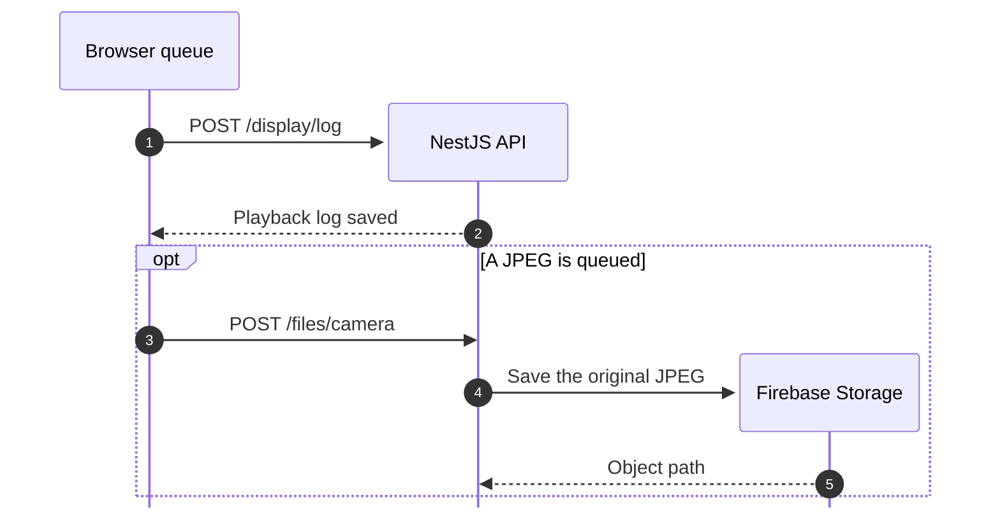

# Cascading sequence diagrams

Read the [step index](../../../docs/architecture/steps/README.md) to find the closest existing example. The [private storage sequence](../../../docs/architecture/steps/02-private-storage/SEQUENCE.txt) shows a staircase with participants introduced inside an optional branch.

## Write the sequence

- Trace the current code from the initiating event. Split the workflow at meaningful handoffs and carry the same identifiers or artifacts between steps. Label real endpoints and distinguish persisted data, queued jobs, and streamed responses.
- Declare the initiator with `participant` at the top. Introduce each later participant with `create participant` immediately before the first message sent to it. Put the declaration inside the branch when the first interaction is conditional. Keep its alias for later messages without declaring it again.
- Use `autonumber` and `sequence.mirrorActors: false`. Reuse the repository's Mermaid theme and participant colors for an existing workflow. Keep arrow labels short and put payload detail, caveats, and implementation links in the guide.
- Model optional paths with `opt` or `alt` when they change the outcome. In the web display workflow, a missing capture means there is no audience measurement. Zero is a possible result of an analyzed image. The insight prompt uses text derived from the playback record and audience metrics.



## Update repository documentation

Keep each step under `docs/architecture/steps/NN-short-slug/` with an English `README.md`, editable `SEQUENCE.txt`, and rendered `diagram.png`. Include a `Request | Response | Why` table in the guide when documenting service handoffs. For additions or renamed steps, update the step index and root README tables with the guide, Mermaid source, and a clickable PNG thumbnail.

Render every changed source from its step folder using the version in the existing guides.

```sh
npx --yes --package @mermaid-js/mermaid-cli@11.17.0 mmdc -i SEQUENCE.txt -o diagram.png -b white -w 1600 -s 1.5
```

If Puppeteer's bundled browser is unavailable, pass `-p` a temporary JSON file with `executablePath` set to an installed Chrome binary. Keep machine-specific configuration outside the repository.

Inspect the rendered PNGs at full size and at the README thumbnail width. Check that the participant boxes descend in message order, each first arrow reaches its box, and labels and branch frames are readable. Verify that the guide, source, and PNG links resolve from both indexes.
