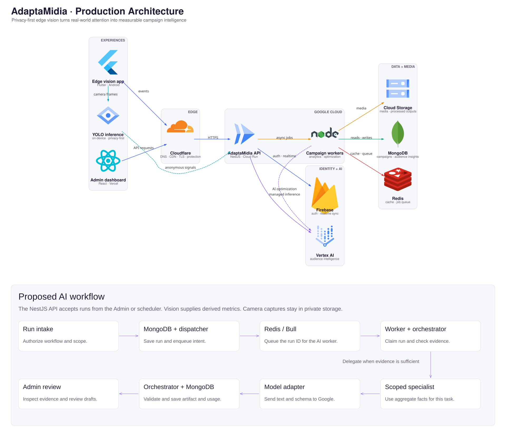
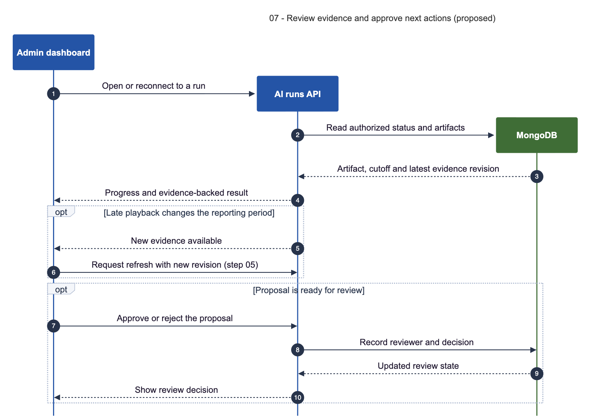

# AdaptaMídia

[Project presentation on Canva](https://www.canva.com/design/DAGzn4-hhkE/WapH1-uL97Op8tOBnVB4_w/edit)

- `frontend/admin` contains the Next.js admin dashboard.
- `frontend/kiosk` contains the Flutter digital signage player for Android tablets.
- `backend/api` contains the NestJS API.
- `backend/vision` contains the Python computer vision service.

## Production architecture


## Display capture to audience insights

Follow the web display from playback and camera capture through private storage, audience detection, and LLM-generated insights. Click a diagram to open it at full size, or browse the [step guides](docs/architecture/steps/README.md).

| Step | Starts with | Flow | Diagram |
| --- | --- | --- | --- |
| **01** | Web display player | **Play content and capture a frame**<br>The display queues a playback log with a camera frame when one is available.<br>[Guide](docs/architecture/steps/01-display-capture/README.md) · [Mermaid source](docs/architecture/steps/01-display-capture/SEQUENCE.txt) | <a href="docs/architecture/steps/01-display-capture/diagram.png"></a> |
| **02** | Browser queue | **Save the log and original capture**<br>The API saves playback metadata in MongoDB, uploads the JPEG to private Firebase Storage, and queues detection.<br>[Guide](docs/architecture/steps/02-private-storage/README.md) · [Mermaid source](docs/architecture/steps/02-private-storage/SEQUENCE.txt) | <a href="docs/architecture/steps/02-private-storage/diagram.png"></a> |
| **03** | Detection queue | **Count people and save the annotated capture**<br>Vision analyzes the stored image. The worker saves the count and the image with bounding boxes.<br>[Guide](docs/architecture/steps/03-people-detection/README.md) · [Mermaid source](docs/architecture/steps/03-people-detection/SEQUENCE.txt) | <a href="docs/architecture/steps/03-people-detection/diagram.png"></a> |
| **04** | Admin or insights queue | **Generate and show audience insights**<br>The API sends playback context and audience metrics as text to the LLM, then saves the generated insight.<br>[Guide](docs/architecture/steps/04-llm-insights/README.md) · [Mermaid source](docs/architecture/steps/04-llm-insights/SEQUENCE.txt) | <a href="docs/architecture/steps/04-llm-insights/diagram.png"></a> |

## Proposed AI architecture

A proposal for a dedicated NestJS AI module with a workflow orchestrator, bounded specialist agents, provider adapters, and durable runs. It uses derived audience metrics and approved context. Private camera captures stay with the Vision pipeline. The proposal covers campaign digests, measurement triage, and experiment drafts alongside the current per-display insight.



[Edit the proposed architecture in Excalidraw](docs/architecture/architecture.excalidraw) · [Read the architecture proposal](docs/architecture/ai/README.md) · [Proposed workflow guides](docs/architecture/steps/README.md#proposed-ai-workflow)

| Step | Starts with | Flow | Diagram |
| --- | --- | --- | --- |
| **05** | Admin or scheduler | **Register a scoped AI run**<br>Authorize the scope, reserve a run in MongoDB, and dispatch its ID.<br>[Guide](docs/architecture/steps/05-ai-run-intake/README.md) · [Mermaid source](docs/architecture/steps/05-ai-run-intake/SEQUENCE.txt) | <a href="docs/architecture/steps/05-ai-run-intake/diagram.png"></a> |
| **06** | AI queue | **Delegate and validate the result**<br>Build an evidence snapshot, select a specialist where useful, and validate the result.<br>[Guide](docs/architecture/steps/06-ai-orchestration/README.md) · [Mermaid source](docs/architecture/steps/06-ai-orchestration/SEQUENCE.txt) | <a href="docs/architecture/steps/06-ai-orchestration/diagram.png"></a> |
| **07** | Admin | **Review evidence and approve next actions**<br>Show run status and evidence, then record a human decision on a proposed action.<br>[Guide](docs/architecture/steps/07-ai-review/README.md) · [Mermaid source](docs/architecture/steps/07-ai-review/SEQUENCE.txt) | <a href="docs/architecture/steps/07-ai-review/diagram.png"></a> |

## Local development

Install Node.js 24, Java 21 for the Firebase Realtime Database emulator, MongoDB with `mongosh`, Redis, and `uv` for Python 3.12. If you use nvm, run `nvm install` and `nvm use` in the repository root. The development and seed commands can also pick an installed Node.js 24 from nvm when your shell uses another version.

Run from the repository root.

```bash
npm ci
npm run dev
```

Turborepo runs the NestJS API in watch mode, Next.js with Fast Refresh, and Uvicorn with reload. It streams logs to the terminal. Press `Ctrl+C` to stop the processes started by Turbo.

| Service | Local URL |
| --- | --- |
| Admin | http://127.0.0.1:4001/login |
| API | http://127.0.0.1:4002/ |
| Vision | http://127.0.0.1:8000/docs |

The setup task creates missing local environment files and prepares the Vision virtual environment on macOS. The infrastructure task starts Redis and the Firebase Realtime Database emulator. It uses MongoDB on port `27017` if available and starts a local instance under `.dev-local/mongo` otherwise.

To create the demo account and display, open another terminal after startup and run `npm run seed` from the repository root. The generated demo password is stored in `LOCAL_ADMIN_PASSWORD` in your local API environment file.

The kiosk runs separately on an Android device or emulator. Put the Android Firebase configuration in `frontend/kiosk/android/app/google-services.json` before building. Follow the [kiosk setup instructions](frontend/kiosk/README.md) for the remaining steps.

To store display camera captures in Firebase Storage, set `DISPLAY_CAPTURE_BUCKET` and `DISPLAY_CAPTURE_CREDENTIALS_FILE` in `backend/api/.env`. Use a private bucket and give the API service account permission to read and write objects there. The display player queues the frame with its playback log, and the API starts detection after the frame is stored. The admin dashboard uses time-limited signed URLs to show the images.

Google Cloud Storage and Vertex AI use Application Default Credentials. To use a service account file, set `GOOGLE_APPLICATION_CREDENTIALS` in `backend/api/.env`. For a remote Firebase Realtime Database, set `FIREBASE_DATABASE_URL` and, if it uses a separate service account, `FIREBASE_RTDB_CREDENTIALS_FILE`.

## Git history

Merge commits link the component histories. The publishing history was filtered to remove previously committed credentials. The original histories and hashes are available from the source repositories below.

### Original repositories

| Component | Monorepo path | Original repository |
| --- | --- | --- |
| API | `backend/api` | [velrino/adaptamidia-api](https://github.com/velrino/adaptamidia-api) |
| Vision | `backend/vision` | [velrino/adaptamidia-vision](https://github.com/velrino/adaptamidia-vision) |
| Admin | `frontend/admin` | [velrino/alphamidia-admin](https://github.com/velrino/alphamidia-admin) |
| Kiosk | `frontend/kiosk` | [velrino/seemidia-app](https://github.com/velrino/seemidia-app) |
