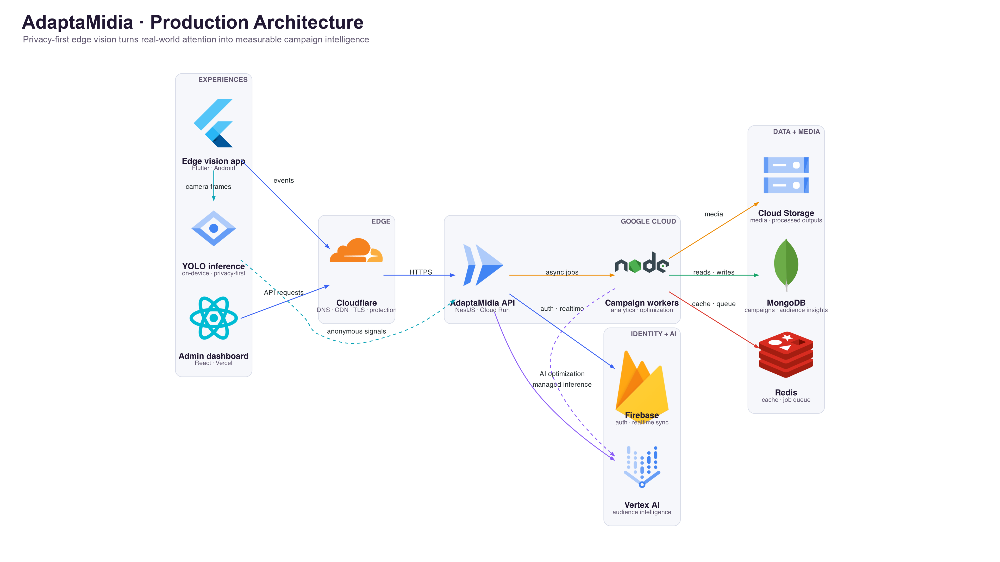
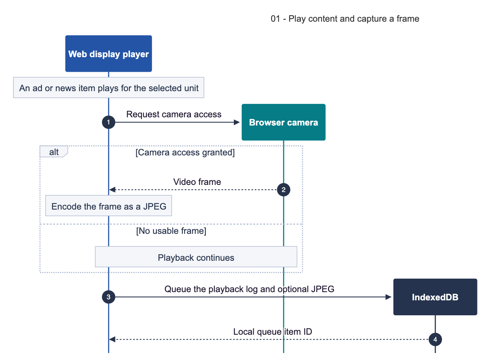
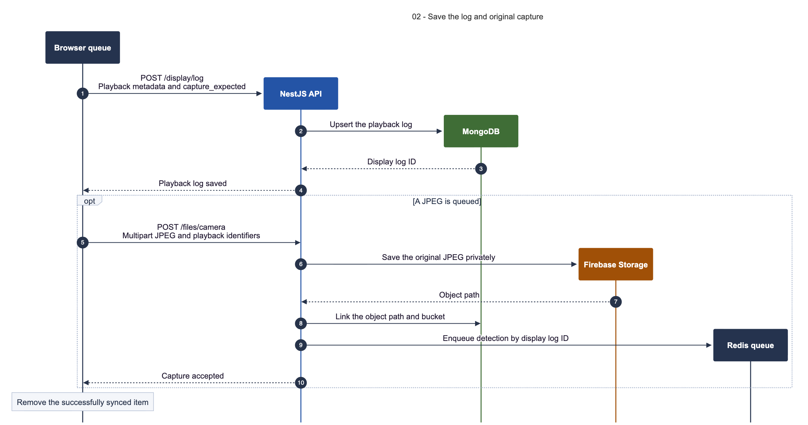
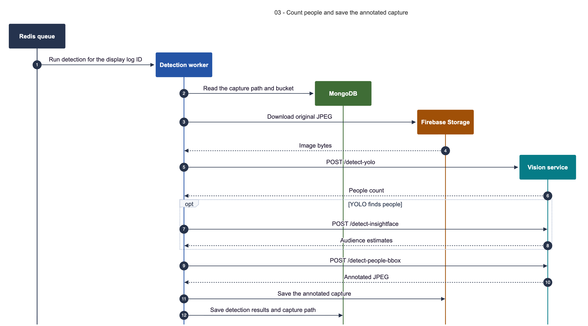
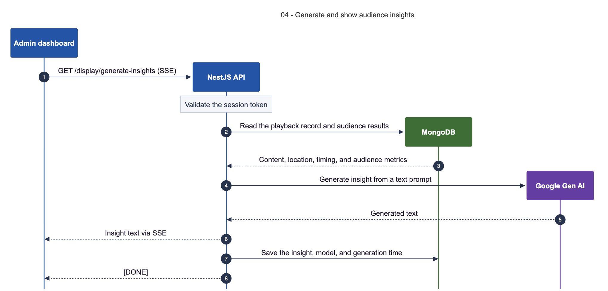

# AdaptaMídia

[Project presentation on Canva](https://www.canva.com/design/DAGzn4-hhkE/WapH1-uL97Op8tOBnVB4_w/edit)

- `frontend/admin` contains the Next.js admin dashboard.
- `frontend/kiosk` contains the Flutter digital signage player for Android tablets.
- `backend/api` contains the NestJS API.
- `backend/vision` contains the Python computer vision service.

## Production architecture



## Display capture to audience insights

Follow the web display from playback and camera capture through private storage, audience detection, and LLM-generated insights. Click a diagram to open it at full size, or browse the [step guides](docs/architecture/steps/README.md).

| Step | Starts with | Flow | Diagram |
| --- | --- | --- | --- |
| **01** | Web display player | **Play content and capture a frame**<br>The display queues a playback log with a camera frame when one is available.<br>[Guide](docs/architecture/steps/01-display-capture/README.md) · [Mermaid source](docs/architecture/steps/01-display-capture/SEQUENCE.txt) | <a href="docs/architecture/steps/01-display-capture/diagram.png"></a> |
| **02** | Browser queue | **Save the log and original capture**<br>The API saves playback metadata in MongoDB, uploads the JPEG to private Firebase Storage, and queues detection.<br>[Guide](docs/architecture/steps/02-private-storage/README.md) · [Mermaid source](docs/architecture/steps/02-private-storage/SEQUENCE.txt) | <a href="docs/architecture/steps/02-private-storage/diagram.png"></a> |
| **03** | Detection queue | **Count people and save the annotated capture**<br>Vision analyzes the stored image. The worker saves the count and the image with bounding boxes.<br>[Guide](docs/architecture/steps/03-people-detection/README.md) · [Mermaid source](docs/architecture/steps/03-people-detection/SEQUENCE.txt) | <a href="docs/architecture/steps/03-people-detection/diagram.png"></a> |
| **04** | Admin or insights queue | **Generate and show audience insights**<br>The API sends playback context and audience metrics as text to the LLM, then saves the generated insight.<br>[Guide](docs/architecture/steps/04-llm-insights/README.md) · [Mermaid source](docs/architecture/steps/04-llm-insights/SEQUENCE.txt) | <a href="docs/architecture/steps/04-llm-insights/diagram.png"></a> |

## Local development

Install Node.js 24, Java 21 for the Firebase emulator, MongoDB with `mongosh`, Redis, and `uv`. Run the launcher from the repository root.

```bash
./dev.sh --seed
```

The launcher creates missing local environment files and starts the admin dashboard at `http://127.0.0.1:4001/login`, the API on port `4002`, and the Vision service on port `8000`. The `--seed` option creates a demo account and display. Press `Ctrl+C` to stop the services started by the launcher.

The kiosk runs separately on an Android device or emulator. Put the Android Firebase configuration in `frontend/kiosk/android/app/google-services.json` before building. Follow the [kiosk setup instructions](frontend/kiosk/README.md) for the remaining steps.

To store display camera captures in Firebase Storage, set `DISPLAY_CAPTURE_BUCKET` and `DISPLAY_CAPTURE_CREDENTIALS_FILE` in `backend/api/.env`. Use a private bucket and give the API service account permission to read and write objects there. The display player queues the frame with its playback log, and the API starts detection after the frame is stored. The admin dashboard uses time-limited signed URLs to show the images.

Google Cloud Storage and Vertex AI use Application Default Credentials. To use a service account file, set `GOOGLE_APPLICATION_CREDENTIALS` in `backend/api/.env`. For a remote Firebase Realtime Database, set `FIREBASE_DATABASE_URL` and, if it uses a separate service account, `FIREBASE_RTDB_CREDENTIALS_FILE`.

## Git history

Merge commits link the component histories. The publishing history was filtered to remove previously committed credentials. The original histories and hashes are available from the source repositories below.

### Original repositories

| Component | Monorepo path | Original repository |
| --- | --- | --- |
| API | `backend/api` | [velrino/adaptamidia-api](https://github.com/velrino/adaptamidia-api) |
| Vision | `backend/vision` | [velrino/adaptamidia-vision](https://github.com/velrino/adaptamidia-vision) |
| Admin | `frontend/admin` | [velrino/alphamidia-admin](https://github.com/velrino/alphamidia-admin) |
| Kiosk | `frontend/kiosk` | [velrino/seemidia-app](https://github.com/velrino/seemidia-app) |
