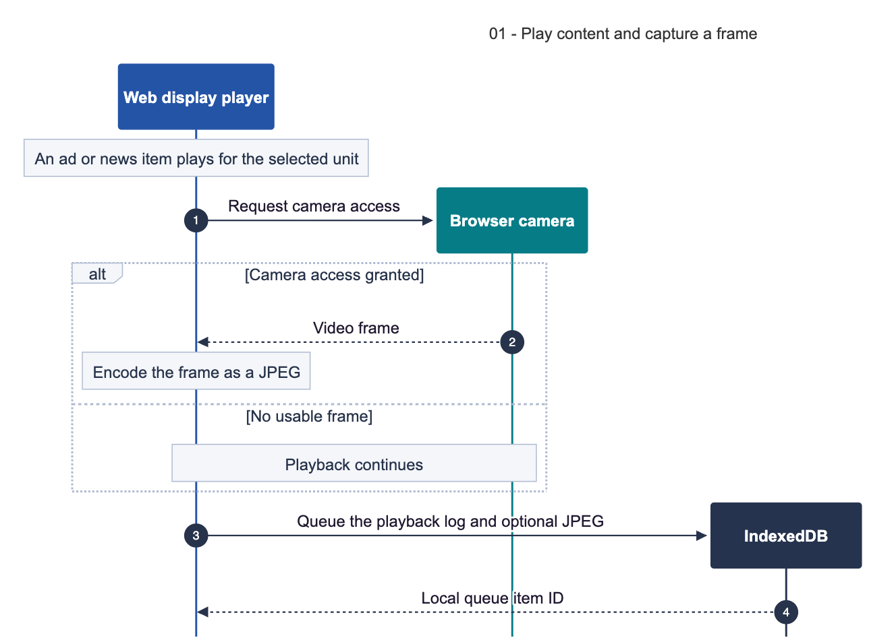

# 01 - Play content and capture a frame

[All steps](../README.md) · [Mermaid source](SEQUENCE.txt) · [Full-size diagram](diagram.png)

The display queues a playback log with a camera frame when one is available.



## Request and response

| Request | Response | Why |
| --- | --- | --- |
| Display → browser camera | Camera stream if available and permitted | Lets the player sample a frame for the current ad or news item. |
| Webcam component → display | JPEG frame when the camera is ready | Associates the sampled frame with the item on screen. |
| Display → IndexedDB | Queued playback log with an optional JPEG blob | Keeps the record and its image together until the browser can sync them. |

The web display captures one still frame when it logs the end of playback, provided camera access and a usable frame are available. If there is no frame, the playback log still enters the browser queue. At this stage the log records playback. The people count is produced later by the Vision service.

Implementation is in the [web display entry point](../../../../frontend/admin/src/components/advertisements/Ads/Ads.tsx), [player](../../../../frontend/admin/src/components/advertisements/Ads/Display.tsx), [camera component](../../../../frontend/admin/src/components/webcam/HiddenWebcam.tsx), and [browser queue](../../../../frontend/admin/src/backend/queue/display_logs_create.ts).

## Regenerate the diagram

Run from this step's folder.

```sh
npx --yes --package @mermaid-js/mermaid-cli@11.17.0 mmdc -i SEQUENCE.txt -o diagram.png -b white -w 1600 -s 1.5
```
