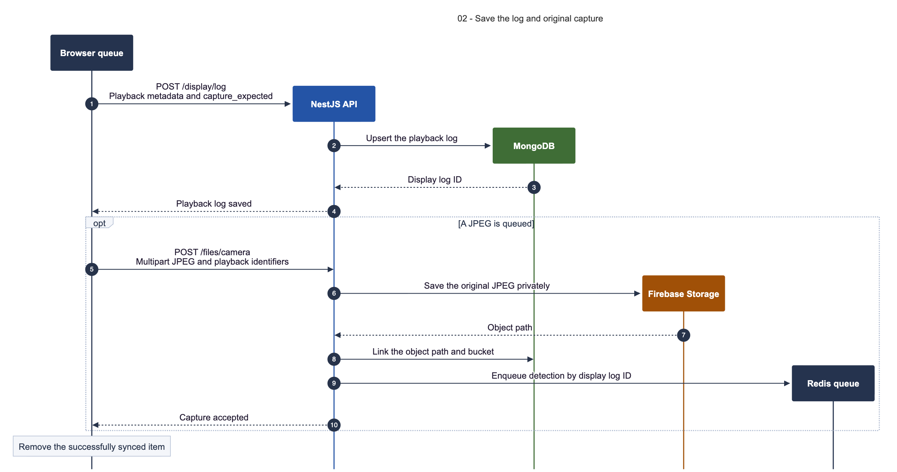

# 02 - Save the log and original capture

[All steps](../README.md) · [Mermaid source](SEQUENCE.txt) · [Full-size diagram](diagram.png)

The API saves playback metadata in MongoDB, uploads the JPEG to private Firebase Storage, and queues detection.



## Request and response

| Request | Response | Why |
| --- | --- | --- |
| Browser → `POST /display/log` | Saved MongoDB playback record | Stores the unit, content, timestamps, playback identifier, and capture expectation before upload. |
| Browser → `POST /files/camera` | Stored object path for the original image | Matches the multipart JPEG to the playback record by unit, content type, content ID, and playback identifier. |
| API → Redis | Detection job keyed by display log ID | Makes the record eligible for analysis after its image is in Storage and linked in MongoDB. |

The object path is `logs/{unit}/{type}/{content}/{identifier}`, with a lowercase content type. The browser clears its IndexedDB item after the log and any associated image are synced. The stable playback record ID lets a retry resolve to the same record. A log without a frame is synced on its own and creates no camera detection job in this flow.

Implementation is in the [browser sync hook](../../../../frontend/admin/src/hooks/useDisplayLogsQueue.ts), [playback log service](../../../../backend/api/src/modules/display-logs/create/create.service.ts), and [camera upload service](../../../../backend/api/src/modules/files/camera/camera.service.ts).

## Regenerate the diagram

Run from this step's folder.

```sh
npx --yes --package @mermaid-js/mermaid-cli@11.17.0 mmdc -i SEQUENCE.txt -o diagram.png -b white -w 1600 -s 1.5
```
