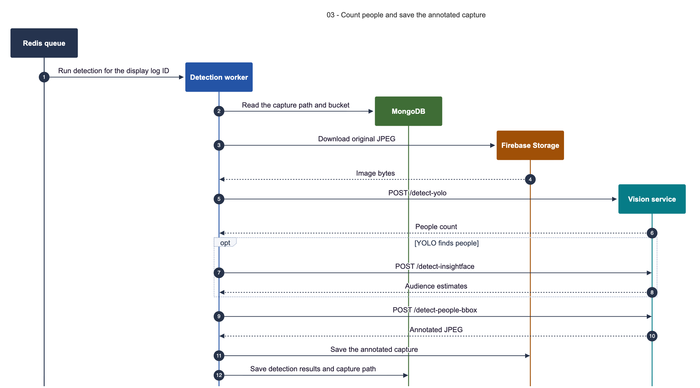

# 03 - Count people and save the annotated capture

[All steps](../README.md) · [Mermaid source](SEQUENCE.txt) · [Full-size diagram](diagram.png)

Vision analyzes the stored image. The worker saves the count and the image with bounding boxes.



## Request and response

| Request | Response | Why |
| --- | --- | --- |
| Worker → Firebase Storage | Original JPEG | Uses the image linked to the playback log. |
| Worker → `POST /detect-yolo` | Person count | Uses YOLO to detect people in the sampled frame. |
| Worker → `POST /detect-insightface` when YOLO finds people | Audience estimates from detectable faces | Adds audience data when face analysis is possible. |
| Worker → `POST /detect-people-bbox` | JPEG with bounding boxes where people are detected | Lets the admin inspect the image alongside the recorded result. |

The count and bounding-box routes use the same person-box filter. When detection runs successfully on a frame with no accepted boxes, it produces a zero count and an image without boxes. A playback log with no measurement displays a dash in the admin table. When annotation succeeds, the worker saves a second object with the `_bbox` suffix in the private bucket and records its path in MongoDB. The admin can request time-limited signed URLs for both images through `POST /display/logs/paginate`.

Implementation is in the [detection worker](../../../../backend/api/src/modules/display-logs/detection/detection.service.ts), [Vision routes](../../../../backend/vision/main.py), and [display log list service](../../../../backend/api/src/modules/display-logs/list/list.service.ts).

## Regenerate the diagram

Run from this step's folder.

```sh
npx --yes --package @mermaid-js/mermaid-cli@11.17.0 mmdc -i SEQUENCE.txt -o diagram.png -b white -w 1600 -s 1.5
```
