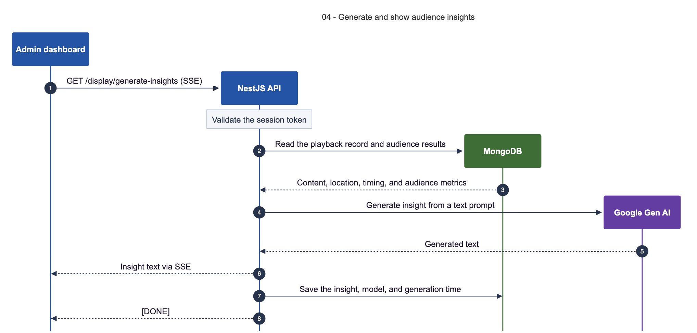

# 04 - Generate and show audience insights

[All steps](../README.md) · [Mermaid source](SEQUENCE.txt) · [Full-size diagram](diagram.png)

The API sends playback context and audience metrics as text to the LLM, then saves the generated insight.



## Request and response

| Request | Response | Why |
| --- | --- | --- |
| Admin → `GET /display/generate-insights` | Authenticated Server-Sent Events (SSE) with the insight text | Shows the generated analysis in the display log modal. |
| API → Google Gen AI | Generated analysis in Brazilian Portuguese | Uses the content title and type, location, playback time and duration, and available audience metrics. |
| API → MongoDB | Saved insight text, model, and generation time | Associates the completed insight with the display log. |

The diagram follows the manual request from the admin. The LLM receives a text prompt built from the playback record and its metrics. The original and annotated images stay in Storage. A missing audience measurement can fall back to zero in the prompt, so the generated text alone cannot establish that a frame was analyzed.

When automatic insights are enabled, the detection worker can also queue generation after saving its results. The insights worker uses the same prompt and saves the result to the display log. The local API environment example sets `DISPLAY_AUTO_INSIGHTS=false`.

Implementation is in the [admin insights view](../../../../frontend/admin/src/components/displays/DisplayLogModal/LLM.tsx), [insights service](../../../../backend/api/src/modules/display-logs/insights/insights.service.ts), [text prompt](../../../../backend/api/src/modules/display-logs/insights/short-prompt.interface.ts), and [model provider](../../../../backend/api/src/shared/google/llm/llm.service.ts).

## Regenerate the diagram

Run from this step's folder.

```sh
npx --yes --package @mermaid-js/mermaid-cli@11.17.0 mmdc -i SEQUENCE.txt -o diagram.png -b white -w 1600 -s 1.5
```
