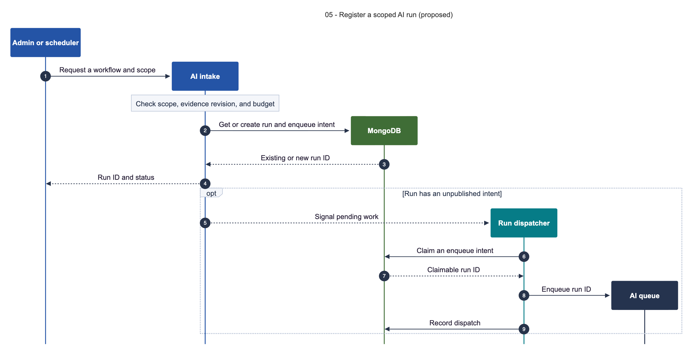

# 05 - Register a scoped AI run

**Status** Proposed.

[All steps](../README.md#proposed-ai-workflow) · [AI architecture proposal](../../ai/README.md) · [Mermaid source](SEQUENCE.txt) · [Full-size diagram](diagram.png)

Authorize the scope, reserve a run in MongoDB, and dispatch its ID.



## Request and response

| Request | Response | Why |
| --- | --- | --- |
| Admin or scheduler → AI intake | Scoped workflow request | Starts an insight or a scheduled digest with an explicit target and evidence revision. |
| AI intake → MongoDB | Run ID and durable enqueue intent | Deduplicates requests and lets a dispatcher recover an unsent job. |
| Dispatcher → AI queue | Job containing the run ID | Keeps execution asynchronous and keeps evidence out of the Redis payload. |

The Admin can reopen the same run using its ID. The proposed deduplication key includes the account, target, workflow version, and evidence revision. An explicit regeneration can create a fresh revision. A scheduling identity needs the same scope checks as an interactive caller.

## Regenerate the diagram

Run from this step's folder.

```sh
npx --yes --package @mermaid-js/mermaid-cli@11.17.0 mmdc -i SEQUENCE.txt -o diagram.png -b white -w 1600 -s 1.5
```
