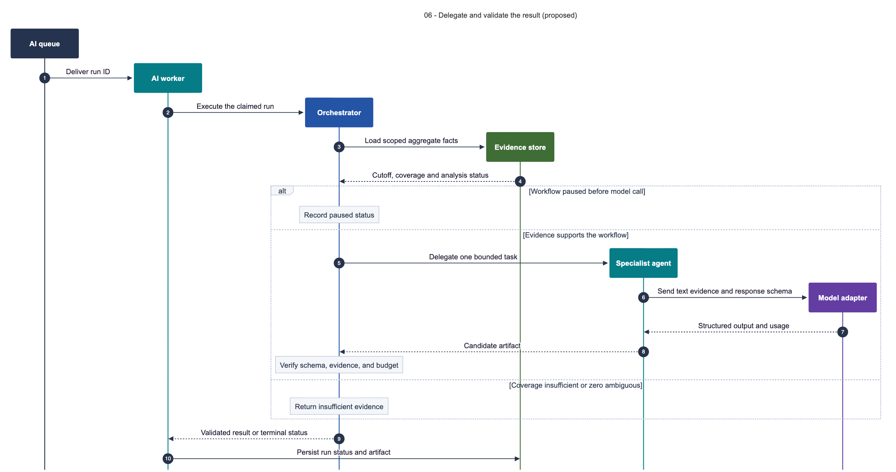

# 06 - Delegate and validate the result

**Status** Proposed.

[All steps](../README.md#proposed-ai-workflow) · [AI architecture proposal](../../ai/README.md) · [Mermaid source](SEQUENCE.txt) · [Full-size diagram](diagram.png)

Check measurement coverage and the workflow pause before invoking a specialist.

A kiosk completion can carry a zero when camera inference was skipped. Until the event records an explicit analysis outcome, classify an ambiguous zero as unknown. Recheck the workflow pause before a provider call and record a paused run so operators can distinguish it from insufficient evidence.



## Request and response

| Request | Response | Why |
| --- | --- | --- |
| Worker → orchestrator | Run ID and execution lease | Limits who can persist the result if a job is retried or stalled. |
| Orchestrator → evidence store | Versioned snapshot | Records which scope, dates, metric definitions, and coverage support the task. |
| Specialist → model adapter | Structured result and reported usage | Isolates the provider while keeping the application in control of what is sent. |
| Orchestrator → worker | Validated artifact or status | Gives the worker one outcome to persist idempotently. |

The evidence store denotes MongoDB for both snapshots and run state. The example uses a single specialist. Rule-based triage can finish without calling a model. An audience count of zero applies only when a frame was analyzed. The adapter receives aggregate-derived text, with no camera frames or signed image URLs.

## Regenerate the diagram

Run from this step's folder.

```sh
npx --yes --package @mermaid-js/mermaid-cli@11.17.0 mmdc -i SEQUENCE.txt -o diagram.png -b white -w 1600 -s 1.5
```
