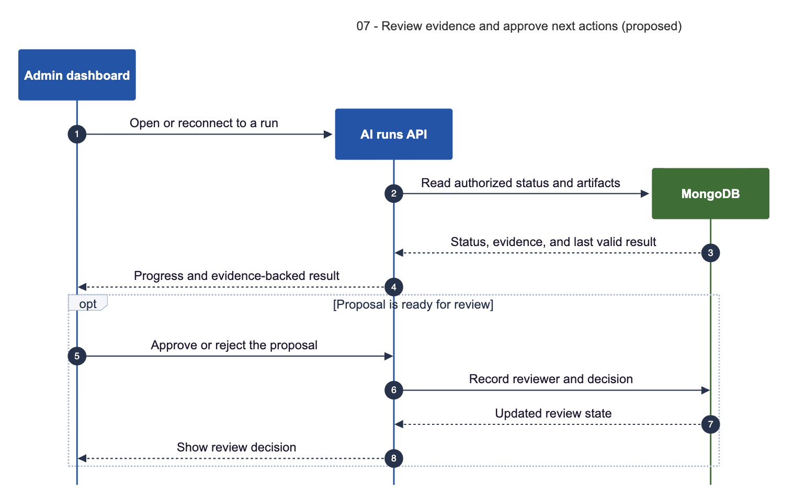

# 07 - Review evidence and approve next actions

**Status** Proposed.

[All steps](../README.md#proposed-ai-workflow) · [AI architecture proposal](../../ai/README.md) · [Mermaid source](SEQUENCE.txt) · [Full-size diagram](diagram.png)

Show run status and evidence, then record a human decision on a proposed action.



## Request and response

| Request | Response | Why |
| --- | --- | --- |
| Admin → AI runs API | Current state and last valid artifact | Users can follow progress or leave and return without starting a new generation. |
| AI runs API → MongoDB | Authorized evidence and audit details | Gives operators metric definitions, coverage, and artifact provenance. |
| Reviewer → AI runs API | Recorded approval or rejection | Separates generated recommendations from human decisions. |

An evidence panel links each claim to its supporting period and aggregate. Recommendations for experiments are drafts. Changes to a campaign or display go through existing product controls.

## Regenerate the diagram

Run from this step's folder.

```sh
npx --yes --package @mermaid-js/mermaid-cli@11.17.0 mmdc -i SEQUENCE.txt -o diagram.png -b white -w 1600 -s 1.5
```
