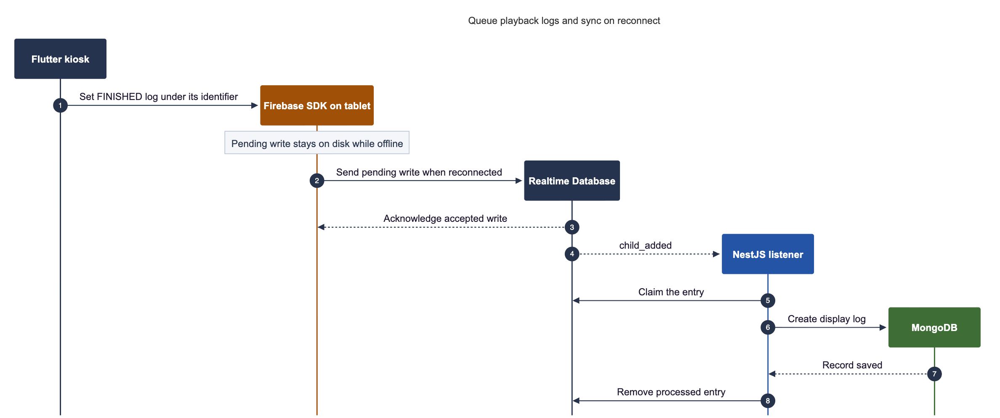
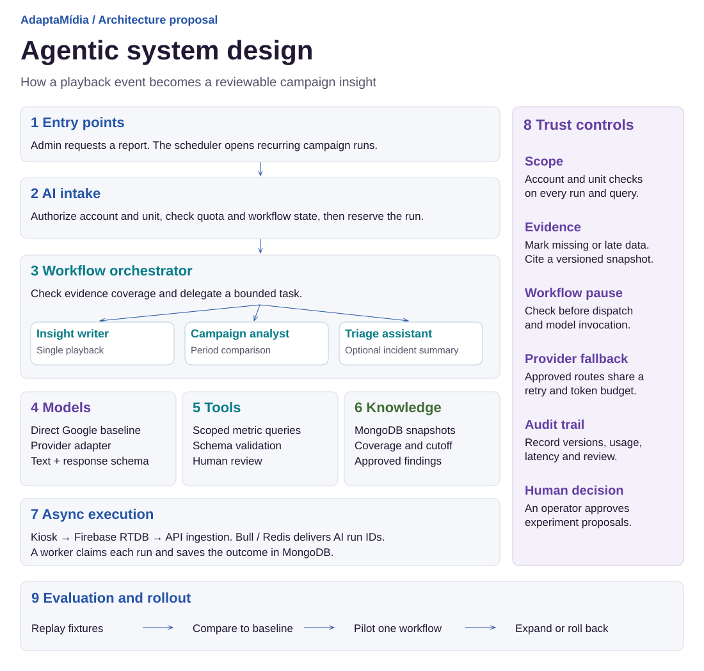
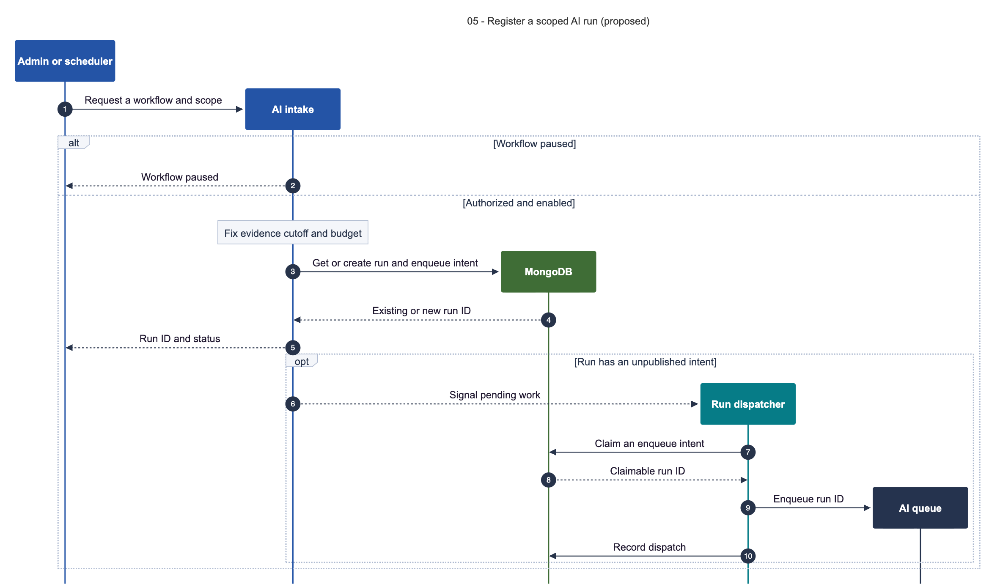
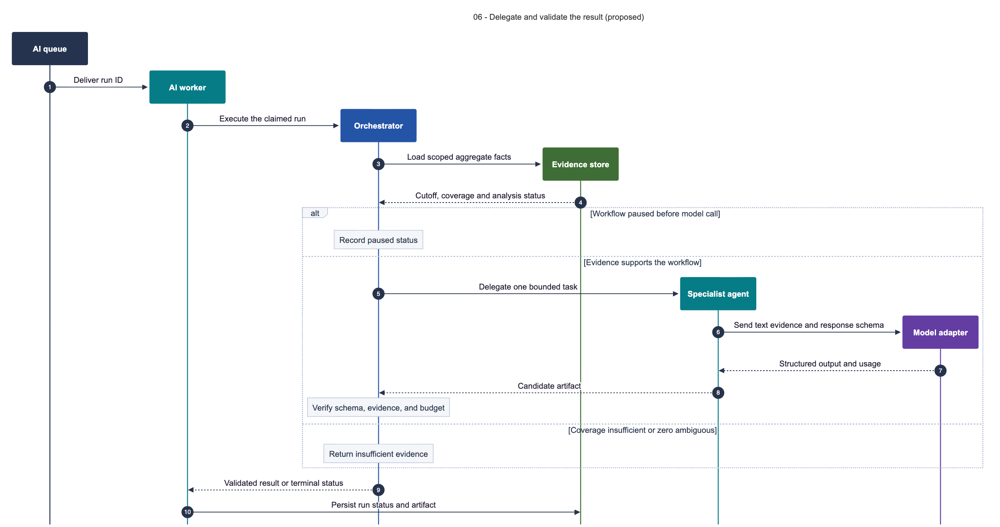

# Display capture to audience insights

[Back to the project README](../../../README.md#display-capture-to-audience-insights)

Follow the web display from playback and camera capture through private storage, audience detection, and LLM-generated insights. Click a diagram to open it at full size.

| Step | Starts with | Flow | Diagram |
| --- | --- | --- | --- |
| **01** | Web display player | **Play content and capture a frame** The display queues a playback log with a camera frame when one is available. [Guide](01-display-capture/README.md) · [Mermaid source](01-display-capture/SEQUENCE.txt) |  |
| **02** | Browser queue | **Save the log and original capture** The API saves playback metadata in MongoDB, uploads the JPEG to private Firebase Storage, and queues detection. [Guide](02-private-storage/README.md) · [Mermaid source](02-private-storage/SEQUENCE.txt) |  |
| **03** | Detection queue | **Count people and save the annotated capture** Vision analyzes the stored image. The worker saves the count and the image with bounding boxes. [Guide](03-people-detection/README.md) · [Mermaid source](03-people-detection/SEQUENCE.txt) |  |
| **04** | Admin or insights queue | **Generate and show audience insights** The API sends playback context and audience metrics as text to the LLM, then saves the generated insight. [Guide](04-llm-insights/README.md) · [Mermaid source](04-llm-insights/SEQUENCE.txt) |  |

## Android kiosk playback and offline sync

Elevator kiosks can lose signal between floors. A running Android player keeps playing previously cached media. The Firebase Realtime Database SDK holds pending playback logs on the tablet and sends them when connectivity returns. Opening the display screen from scratch requires an online playlist load. [Kiosk workflow guide](kiosk/README.md)

| Step | Guide and source | Diagram |
| --- | --- | --- |
| 01 | [Prepare and play cached media](kiosk/01-offline-playback/README.md) · [Mermaid source](kiosk/01-offline-playback/SEQUENCE.txt) |  |
| 02 | [Queue playback logs and sync on reconnect](kiosk/02-log-sync/README.md) · [Mermaid source](kiosk/02-log-sync/SEQUENCE.txt) |  |

## Proposed AI workflow

[Editable system design in Excalidraw](../ai/system-design.excalidraw)

These steps describe the possible next architecture after detection. Steps 01–04 document the current product. See the [AI architecture proposal](../ai/README.md) for decisions, alternatives, and rollout criteria.

| Step | Starts with | Flow | Diagram |
| --- | --- | --- | --- |
| **05** | Admin or scheduler | **Register a scoped AI run** Check scope and workflow pause status before reserving a run for an evidence cutoff. [Guide](05-ai-run-intake/README.md) · [Mermaid source](05-ai-run-intake/SEQUENCE.txt) |  |
| **06** | AI queue | **Delegate and validate the result** Check measurement coverage and the workflow pause before invoking a specialist. [Guide](06-ai-orchestration/README.md) · [Mermaid source](06-ai-orchestration/SEQUENCE.txt) |  |
| **07** | Admin | **Review evidence and approve next actions** Show the evidence cutoff, offer a revision for late events, and record review decisions. [Guide](07-ai-review/README.md) · [Mermaid source](07-ai-review/SEQUENCE.txt) |  |
