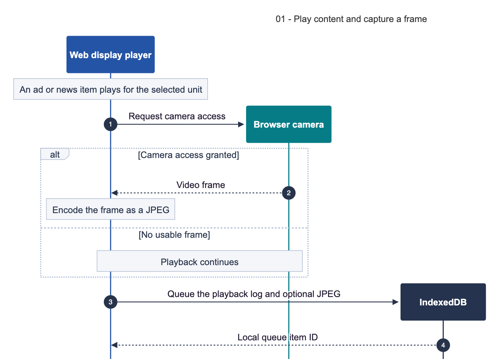
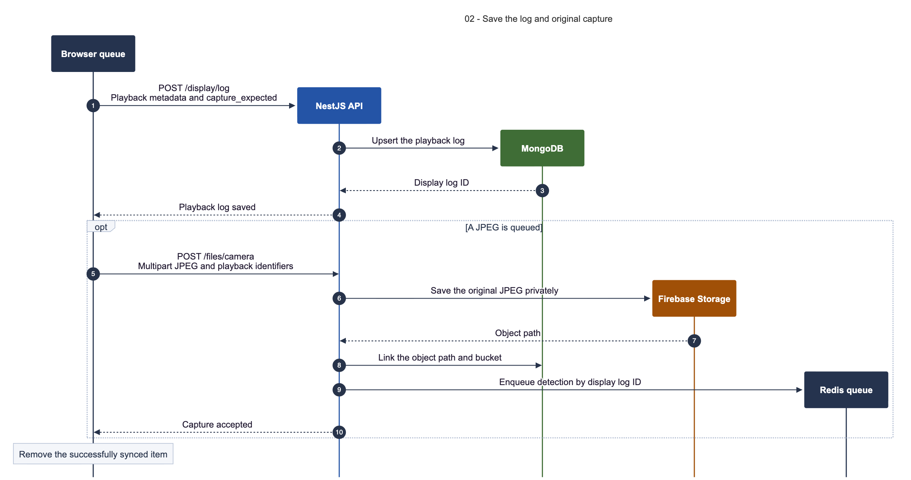
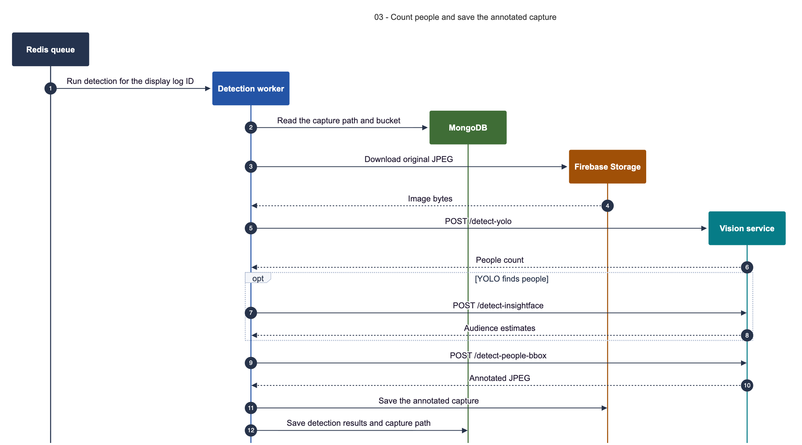
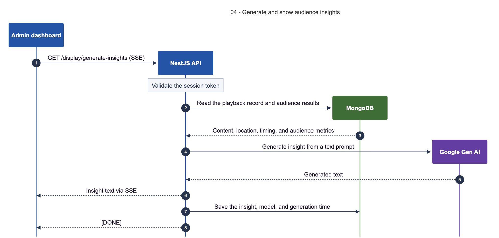

# Display capture to audience insights

[Back to the project README](../../../README.md#display-capture-to-audience-insights)

Follow the web display from playback and camera capture through private storage, audience detection, and LLM-generated insights. Click a diagram to open it at full size.

| Step | Starts with | Flow | Diagram |
| --- | --- | --- | --- |
| **01** | Web display player | **Play content and capture a frame** The display queues a playback log with a camera frame when one is available. [Guide](01-display-capture/README.md) · [Mermaid source](01-display-capture/SEQUENCE.txt) |  |
| **02** | Browser queue | **Save the log and original capture** The API saves playback metadata in MongoDB, uploads the JPEG to private Firebase Storage, and queues detection. [Guide](02-private-storage/README.md) · [Mermaid source](02-private-storage/SEQUENCE.txt) |  |
| **03** | Detection queue | **Count people and save the annotated capture** Vision analyzes the stored image. The worker saves the count and the image with bounding boxes. [Guide](03-people-detection/README.md) · [Mermaid source](03-people-detection/SEQUENCE.txt) |  |
| **04** | Admin or insights queue | **Generate and show audience insights** The API sends playback context and audience metrics as text to the LLM, then saves the generated insight. [Guide](04-llm-insights/README.md) · [Mermaid source](04-llm-insights/SEQUENCE.txt) |  |
