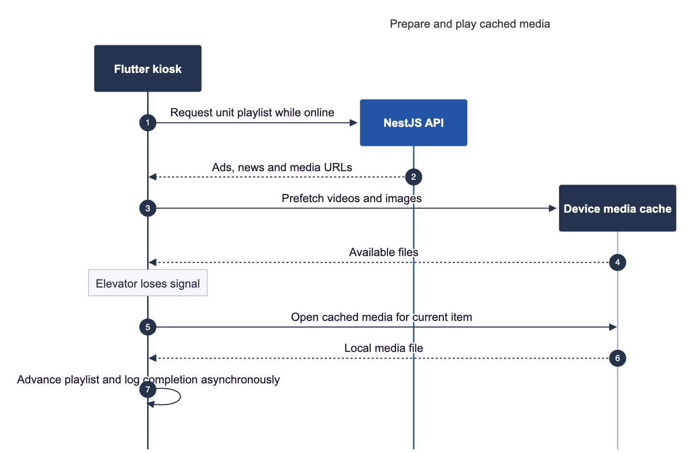

# Prepare and play cached media

[Offline kiosk workflow](../README.md) · [Mermaid source](SEQUENCE.txt)

A tablet entering an elevator can keep showing the playlist it loaded while it had signal. Two things must be available on the device: the active playlist in memory and the media files for the items it plays.

| Request | Response | Why |
| --- | --- | --- |
| The authenticated kiosk calls `GET /display/unit/{unitId}`. | The API returns the unit playlist and media URLs. | The display screen needs a successful initial load. Restarting it offline can leave cached files on disk without a playlist to play. |
| The player prepares videos for its screen orientation and preloads news images. | The media caches return local files. When the prepared list contains cached items, the player uses that list. | These files allow a running display to continue through a signal drop. |
| The active screen checks for fresh content every ten minutes. | A failed refresh leaves the current playlist in memory. | Playback can continue while the elevator is between floors. |

When an item finishes, the display advances and starts logging asynchronously. Firebase synchronization follows its own connection lifecycle, independently of the ten-minute playlist refresh.

[Flutter display screen](../../../../../frontend/kiosk/lib/screens/authenticated/display_screen.dart) · [Video cache](../../../../../frontend/kiosk/lib/services/video_cache_service.dart) · [Image cache](../../../../../frontend/kiosk/lib/services/image_cache_service.dart)
