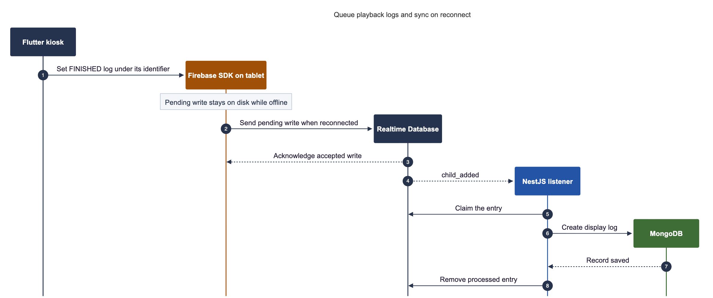

# Queue playback logs and sync on reconnect

[Offline kiosk workflow](../README.md) · [Mermaid source](SEQUENCE.txt)

Each completed ad or news item gets a millisecond timestamp as its identifier. The kiosk writes a `FINISHED` event with the content, unit, device and playback times. When a camera frame and the models are available, detection runs on the tablet. Firebase receives the event and its results. The capture file stays on the device and the detection service attempts to delete it after logging. A zero count can also mean capture or inference was skipped.

| Request | Response | Why |
| --- | --- | --- |
| The kiosk calls `set(body)` at `DISPLAY_LOGS/{identifier}` (development uses `DEV_DISPLAY_LOGS`). | With Realtime Database disk persistence enabled, the mobile SDK keeps pending writes locally during an outage. | The player advances without waiting for a server acknowledgement. |
| The SDK reconnects to the configured Realtime Database. | Firebase applies and acknowledges writes allowed by its authentication and rules. | A cloud record becomes available to the API even if the next playlist refresh is minutes away. |
| The API receives `child_added` and claims the entry. | After creating the MongoDB display log, the API removes the Firebase entry. | MongoDB holds the processed playback history. If processing fails, the listener releases the claim. |

The kiosk configures a 20 MiB Realtime Database cache. Media files have their own caches. The kiosk and the API listener must point to the same Firebase database and environment path for ingestion.

[Firebase initialization](../../../../../frontend/kiosk/lib/services/firebase_service.dart) · [On-device detection](../../../../../frontend/kiosk/lib/services/background_detection_service.dart) · [Log write](../../../../../frontend/kiosk/lib/services/display_log_service.dart) · [Firebase listener](../../../../../backend/api/src/shared/firebase/firebase-database.service.ts) · [MongoDB ingestion](../../../../../backend/api/src/modules/display-logs/create/create.service.ts)
