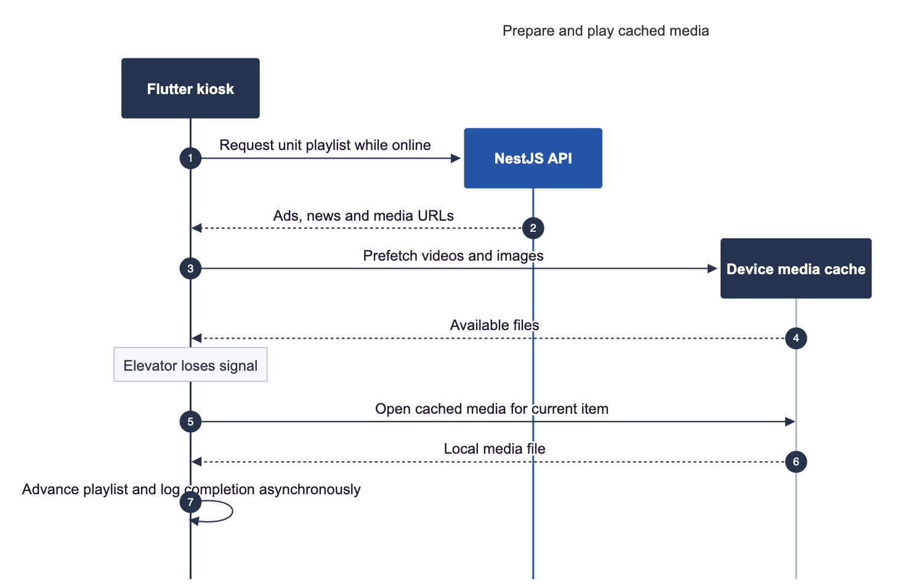
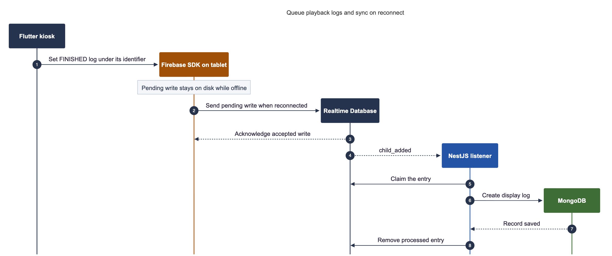

# Android kiosk playback and offline sync

Elevator kiosks can lose signal between floors. A running Android player keeps playing previously cached media. The Firebase Realtime Database SDK holds pending playback logs on the tablet and sends them when connectivity returns. Opening the display screen from scratch requires an online playlist load.

| Step | Guide and source | Diagram |
| --- | --- | --- |
| 01 | [Prepare and play cached media](01-offline-playback/README.md) · [Mermaid source](01-offline-playback/SEQUENCE.txt) |  |
| 02 | [Queue playback logs and sync on reconnect](02-log-sync/README.md) · [Mermaid source](02-log-sync/SEQUENCE.txt) |  |
